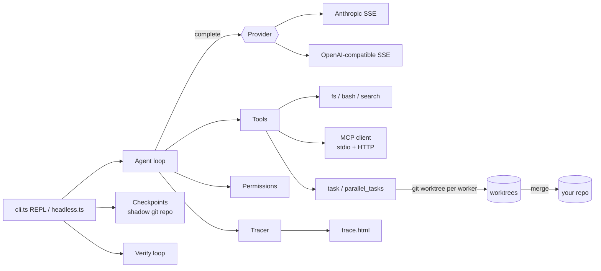

# MOO

**A terminal coding agent in TypeScript** — inspired by Claude Code's architecture, with multi-provider support, MCP, checkpoint/rewind, git-worktree parallel sub-agents, and a plan → verify loop.

[](https://github.com/Ljm0904/MOOCODING-AGENT/actions/workflows/ci.yml)
  

> Add a terminal recording here (`vhs` / `asciinema`).

## Install

```bash
npm i -g moo-agent       # or: npx moo-agent
cd your-project && moo   # first run walks you through provider → base URL → API key → model
```

Works with the Anthropic API and any OpenAI-compatible endpoint (OpenAI, DeepSeek, Qwen, Moonshot, Ollama, …). Requires Node ≥ 20 and `git`; macOS and Linux (shell tools use `bash`).

## What it does

| | |
|---|---|
| **Agent loop** | Streaming tool use, parallel read-only tools, Ctrl+C interrupt, automatic context compaction, session resume (`moo -c`) |
| **Tools** | read / edit / write file, bash, glob, grep, todo list, read-only research sub-agent |
| **Providers** | Anthropic + OpenAI-compatible behind one message format; retries, backoff, prompt caching |
| **Permissions** | `default` / `auto-edit` / `yolo` / `plan` modes, per-tool "always allow", writes confined to the project, catastrophic commands blocked |
| **MCP** | stdio + streamable-HTTP servers, `.mcp.json` compatible, project configs require one-time trust |
| **Checkpoints** | Snapshot before every prompt; `/rewind n code\|chat\|both`; never touches your own `.git` |
| **Parallel sub-agents** | `parallel_tasks` runs independent tasks in isolated git worktrees and merges them back; conflicts are kept, not forced |
| **Plan → verify** | `/plan`: read-only planning → your approval → execution → tests/lint/typecheck → automatic repair rounds → report |
| **Observability** | `/trace`: HTML swimlane timeline of every LLM call, tool call, verification and sub-agent, with tokens and failures |
| **Headless** | `moo -p "…"` with text/JSON output and exit codes, for scripts and CI |
| **Terminal UX** | Streaming markdown, syntax highlighting, animated status line |

## Usage

```bash
moo                                   # interactive REPL
moo "explain the auth flow"           # REPL with an initial prompt
moo -c                                # resume last session in this directory
moo --provider openai --model deepseek-chat
```

Slash commands: `/plan` `/checkpoints` `/rewind` `/diff` `/verify` `/trace` `/mcp` `/mode` `/model` `/setup` `/compact` `/cost` `/todos` `/clear` `/help`.

### Headless / CI

```bash
moo -p "fix the failing test in src/parser" --mode auto-edit --verify --output-format json
git diff | moo -p "review this diff for bugs"
```

- `stdout` carries **only** the result (plain text, or one JSON object with `result`, `session_id`, `usage`, `num_tool_calls`, `verification`); progress goes to `stderr`.
- Nothing can prompt, so un-approved edits/commands are denied. Use `--mode auto-edit` (edits) or `--mode yolo` (everything — only in a sandbox/CI container).
- Piped stdin is appended to the prompt; if stdin stays silent for 1.5 s it is ignored.
- Exit codes: `0` success · `1` error · `2` verification failed (`--verify`).

## Configuration

`~/.moo/config.json` (created by the setup wizard, mode 600):

```json
{ "provider": "openai", "model": "deepseek-chat",
  "openai": { "apiKey": "…", "baseUrl": "https://api.deepseek.com/v1" } }
```

Environment overrides: `ANTHROPIC_API_KEY`, `OPENAI_API_KEY`, `OPENAI_BASE_URL`, `MOO_MODEL`, `MOO_PROVIDER`. Project instructions: `MOO.md` (falls back to `CLAUDE.md` / `AGENTS.md`); user-level: `~/.moo/MOO.md`.

**MCP** — `~/.moo/mcp.json` or `./.mcp.json` (same format as Claude Code; `${VAR}` is expanded):

```json
{ "mcpServers": {
    "fs":   { "command": "npx", "args": ["-y", "@modelcontextprotocol/server-filesystem", "."] },
    "docs": { "url": "https://example.com/mcp", "headers": { "Authorization": "Bearer ${DOCS_TOKEN}" } } } }
```

Tools appear as `mcp__<server>__<tool>` and ask for permission unless the server marks them `readOnlyHint`. A project `.mcp.json` runs code on your machine, so MOO asks once per exact config.

Other switches: `MOO_NO_MCP=1`, `MOO_NO_ANIM=1`, `MOO_RAW=1` (no markdown rendering), `MOO_CTX_LIMIT` (compaction threshold in tokens).

## Architecture



Design rationale is in [docs/DESIGN.md](docs/DESIGN.md).

## Known limitations

- Worker sub-agents run `bash` auto-approved and unsandboxed; only file writes are confined to their worktree. Use `parallel_tasks` on repositories you trust, ideally in a container.
- Rewind restores the project directory only: not side effects elsewhere, nor commits/merges made in your real repo.
- MCP: tools only (no resources/prompts/OAuth); workers don't get MCP tools.
- Syntax highlighting is a line-based approximation. Windows is not supported.

## Development

```bash
npm install && npm run check && npm test   # tests need no API key
npm start                                  # run from source (Node ≥ 22.18)
npm run build                              # compile to dist/ (what gets published)
```

See [CONTRIBUTING.md](CONTRIBUTING.md) and [CHANGELOG.md](CHANGELOG.md). MIT licensed.
